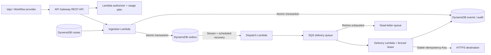

# Serverless Webhook Event Router & Processing Engine

AWS SAM service for authenticated, tenant-isolated webhook ingestion, dynamic DynamoDB routing and durable asynchronous delivery. Native Vapi `end-of-call-report` messages and workflow envelopes are supported. Source and deployment assets: [`webhook-router/`](webhook-router/).

## Documentation

Start with the [documentation index](webhook-router/docs/README.md) or the [step-by-step getting started guide](webhook-router/docs/getting-started.md).

| Audience | Guide |
|---|---|
| New developers | [Local setup and first deployment](webhook-router/docs/getting-started.md), [development and testing](webhook-router/docs/development.md) |
| Webhook producers | [HTTP API and Vapi integration](webhook-router/docs/api.md), [OpenAPI specification](webhook-router/docs/openapi.yaml) |
| Integration engineers | [Routing, transformations and configuration](webhook-router/docs/configuration.md), [destination contract](webhook-router/docs/api.md#downstream-delivery-contract) |
| Platform engineers | [Architecture](webhook-router/docs/architecture.md), [DynamoDB data model](webhook-router/docs/data-model.md), [deployment and recovery](webhook-router/docs/runbook.md) |
| Operators | [Metrics and alarms](webhook-router/docs/observability.md), [troubleshooting](webhook-router/docs/troubleshooting.md) |
| Reviewers and release owners | [Security](webhook-router/docs/security.md), [acceptance gates](webhook-router/docs/acceptance.md), [verification evidence](webhook-router/docs/verification.md) |

## Repository layout

```text
webhook-router/
  src/router/            Lambda handlers, validation, transport and telemetry
  src/requirements.txt   Exact runtime dependency pins
  template.yaml          SAM infrastructure, roles, queues, tables and alarms
  samconfig.toml         Environment-specific deployment defaults
  scripts/               Operator tools, acceptance probe and dependency audit
  tests/                 Isolated contract, failure-path and infrastructure tests
  schemas/               Workflow envelope JSON Schema
  examples/              Synthetic Vapi/workflow payloads and route definitions
  docs/                  Human-readable guides and OpenAPI contract
.github/workflows/        CI verification for the router and legacy application
frontend/, backend/      Separate legacy React/Laravel DBaaS prototype
```

The webhook service runs on Python 3.12 and AWS managed services. It does not require the legacy React frontend, Laravel API, PHP, Composer or the root Docker Compose stack.



**Readiness:** implemented for deployment and local verification; not certified as live production. No AWS stack has been deployed by this task. AWS acceptance, IAM/network checks, alarm delivery and destination idempotency must pass before production promotion. No measured sub-200 ms or 70% business-impact claim is made.

## Requirement coverage

| Requirement | Implementation |
|---|---|
| API Gateway authorization and rate limits | REST API, bearer authorizer, tenant usage keys returned by authorizer, stage/usage-plan throttles |
| JSON validation | Strict JSON, 64 KiB cap, provider validation and per-route JSON Schema; no remote schema references or executable transformations |
| Vapi / custom workflows | Native Vapi reports normalized to `vapi.call_ended`; `{id,type,data}` workflow contract |
| Dynamic routing | Consistent lookup by authenticated tenant and type; versioned endpoints, JSON-pointer mapping, destination secret ARN |
| State, audit and idempotency | On-demand DynamoDB; atomic conditional event + outbox writes; raw bodies; payload conflicts rejected |
| Durable delivery | Outbox, Streams, scheduled recovery, SQS retry/DLQ, fenced worker leases |
| Repeatable environments | SAM configs for dev/staging/prod, scoped roles, retained/PITR tables |
| CloudWatch | Traffic, integration latency, custom process-memory metrics, outcomes, backlog and SNS alarms |
| Operations | Credential onboarding/rotation, optimistic route updates, replay, preflight and opt-in load probe |

**Delivery contract:** at-least-once delivery with bounded automated retries and durable failure escalation. Exactly-once *business effects* require the destination to atomically honor `Idempotency-Key`. A timeout after the destination commits cannot otherwise be distinguished from failure. Deduplication/audit retention defaults to 90 days, with asynchronous TTL removal. See [architecture](webhook-router/docs/architecture.md).

## Local verification

Python 3.12, from PowerShell:

```powershell
python -m venv .venv
.\.venv\Scripts\python -m pip install -r webhook-router/requirements-dev.txt
cd webhook-router
..\.venv\Scripts\python -m pytest --cov=router --cov-report=term-missing
..\.venv\Scripts\ruff check src tests scripts
..\.venv\Scripts\ruff format --check src tests scripts
..\.venv\Scripts\python scripts/audit_dependencies.py
..\.venv\Scripts\sam validate --lint --region eu-west-3
```

Tests use Moto and fake credentials, not the configured AWS account. CI validates, audits pinned runtime dependencies against OSV, and builds without deploying. [Verification evidence](webhook-router/docs/verification.md): 67 tests pass, 92.68% runtime coverage, successful SAM validation/build and no known OSV findings for the 13 pinned runtime packages.

## Deployment

Read the [runbook](webhook-router/docs/runbook.md). Prepare a dedicated AWS role, API Gateway regional logging role, approved hosts, destination credentials and alarm recipient. These commands create billable resources when an operator runs deployment:

```powershell
cd webhook-router
..\.venv\Scripts\python scripts/manage.py --region eu-west-3 preflight
..\.venv\Scripts\sam build
..\.venv\Scripts\sam deploy --config-env dev --guided
```

Use staging/prod configs for promotion. Explicitly supply `AllowedDestinationHosts` and `AlarmEmail`; empty hosts intentionally deny all deliveries. Retained resources require deliberate removal/migration.

```powershell
..\.venv\Scripts\python scripts/manage.py --region eu-west-3 --stack webhook-router-dev configure-client --tenant demo --providers workflow,vapi
..\.venv\Scripts\python scripts/manage.py --region eu-west-3 --stack webhook-router-dev put-route --file examples/route.json --sample examples/workflow.json
..\.venv\Scripts\python scripts/manage.py --region eu-west-3 --stack webhook-router-dev put-route --file examples/vapi-route.json --sample examples/vapi.json
```

Tokens are entered with a hidden prompt. Configure the provider with `Authorization: Bearer <token>`; API Gateway receives the usage key from the authorizer. For Vapi, use a saved server configuration and custom credential, subscribed to asynchronous end-of-call reports. Synchronous tool calls are outside this service's contract. [Vapi authentication](https://docs.vapi.ai/server-url/server-authentication), [server events](https://docs.vapi.ai/server-url/events).

The earlier React/Laravel DBaaS prototype is preserved in `frontend/` and `backend/`, with its [documentation](docs/dbaas.md). It is a separate product, does not administer this AWS service, and retains simulated cloud operations.

Git timestamps follow a requested historical schedule; [provenance](webhook-router/docs/history-provenance.md) records actual creation on October 27, 2026.
