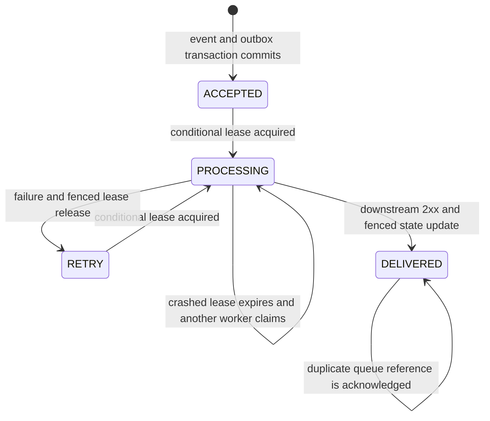

# Data model and event lifecycle

Three DynamoDB tables separate current routing configuration, accepted event state, and outstanding queue publications. They use on-demand capacity, server-side encryption and point-in-time recovery. Production tables have deletion protection; tables are retained on stack deletion/replacement. The [template](../template.yaml) is authoritative.

## Events table

Partition key: `pk` (string). There is no sort key or event-search secondary index.

```text
pk = tenant_id + "#" + SHA256(normalized_event_id encoded as UTF-8)
```

Hashing the ID gives a fixed-size key suffix while retaining the tenant namespace. It is not payload encryption. An event ID is unique across event types within a tenant.

| Attribute | Type | Meaning |
|---|---|---|
| `pk` | String | Internal event key and downstream idempotency key |
| `tenant_id` | String | Authenticated namespace |
| `event_id` | String | Normalized provider ID |
| `event_type` | String | Normalized routing type |
| `payload_hash` | String | SHA-256 of parsed/sorted-key incoming payload serialization |
| `raw_body` | String | Decoded UTF-8 request body for accepted-event audit |
| `route_json` | String | Serialized operational route snapshot; excludes tenant key and enabled flag |
| `delivery_json` | String | Serialized normalized/projected body to send |
| `status` | String | `ACCEPTED`, `PROCESSING`, `RETRY` or `DELIVERED` |
| `attempts` | Number | Number of successful worker lease acquisitions; starts at zero |
| `created_at` | Number | Acceptance time, Unix seconds |
| `expires_at` | Number | Acceptance time plus configured retention; DynamoDB TTL attribute |
| `lease_owner`, `lease_until` | String / Number | Temporary fencing token and deadline; absent after normal completion/release |
| `updated_at` | Number | Written when acquiring a lease; not a universal last-modification timestamp |
| `delivered_at` | Number | Written when the worker records downstream 2xx |
| `last_error_type` | String | Exception class after a delivery failure; not the response body or secret-bearing message |

`route_json` and `delivery_json` are JSON **strings**, not DynamoDB map attributes. A previous `last_error_type` can remain after a successful retry; use `status`/`delivered_at` as completion evidence. Attempts count is not the same as SQS receive count: malformed queue messages or active-lease retries may increment receives without acquiring a lease.

## State transitions



DLQ placement is an SQS state, **not** a `DEAD_LETTERED` event status. A dead-lettered event can remain `RETRY`, or `PROCESSING` after a crash. Successful destination processing followed by a lost completion update can also leave a non-delivered event state. That ambiguity is why replay must retain the same receiver idempotency key.

Duplicate ingestion reads existing state before fetching the current route. Matching fingerprints return a duplicate acknowledgement with no new outbox; differing fingerprints return 409. Deleting an event record to “clear” a duplicate bypasses the protection and is not a supported recovery method.

## Routes table

Partition key: `tenant_id` (string). Sort key: `event_type` (string). No TTL or stream is configured for routes.

The current row contains versioned endpoint, schema, mapping and optional destination secret ARN. A consistent read selects it at ingestion. The table retains only the current version; historical event snapshots do not constitute a complete route-version archive. Keep reviewed route files/change records in version control and enable appropriate CloudTrail data events.

See [configuration](configuration.md#route-document) for field definitions and conditional update behavior.

## Outbox table

Partition key: `pk` (string), matching the event key. The due GSI has partition key `shard` (string), sort key `due_at` (number), and projects all attributes.

| Attribute | Meaning |
|---|---|
| `pk` | Event reference to publish |
| `shard` | Hash-derived bucket `0` through `15` |
| `due_at` | Acceptance time; query eligibility/order for recovery |
| `created_at` | Acceptance time; oldest-item age metric |

The outbox and event record are written in the same conditional transaction. No API response acknowledges half of that transaction. The dispatcher deletes an outbox entry after SQS accepts the reference. If deletion fails after publication, another dispatch may occur; worker/destination idempotency handles it.

The NEW_IMAGE stream drives low-latency dispatch. Scheduled recovery queries due rows because stream records have finite retention. The GSI is eventually consistent, and recovery is a bounded page per shard per run. `due_at` is not an exponential-backoff scheduler and is not moved forward after failed dispatch. There is no outbox TTL.

## Queue message contracts

Delivery queue and its DLQ carry small references:

```json
{"event_key":"demo#<64-character-sha256-hex>"}
```

Bodies are not re-copied into SQS. The worker consistently reads the event record to obtain its pinned body/route. The separate stream-failure queue carries stream failure-destination records; it is not interchangeable with the delivery queue. Do not blindly redrive stream-failure envelopes into the delivery queue. Reconciliation operates on the retained outbox instead.

## Retention and recovery boundaries

| Data | Policy | Operational implication |
|---|---|---|
| Event audit/state | Default 90 days, configurable 30–365; TTL asynchronous | Deduplication may continue longer; after deletion the ID can be accepted again |
| Outbox | No TTL; removed after successful enqueue | Publication intent persists, but an outage exceeding event retention can outlive its source audit |
| Delivery queue | 4 days | Resolve sustained outages/backlogs before queue retention expires |
| Delivery DLQ and stream-failure queue | 14 days | Alerts require a timely operator response |
| Routes | No automatic expiry | Keep configuration and retention ownership explicit |
| Logs | 30 days dev/staging, 90 days prod | Not a replacement for the raw event audit |

Replay explicitly rejects events past `expires_at` even if DynamoDB has not physically removed them. Normal workers rely on record existence and do not implement the same explicit expiry check; TTL removal timing is therefore not an exact processing cutoff. Review compliance requirements before using retention as a strict erasure or delivery deadline.

## Locating an event

Compute the key locally from a known tenant and normalized event ID; this does not send a request:

```powershell
python -c "import hashlib; tenant='demo'; event_id='workflow-run-001'; print(tenant+'#'+hashlib.sha256(event_id.encode()).hexdigest())"
```

For Vapi, use the prefixed normalized ID, not the bare call ID. Get `EventsTableName` from stack outputs. With an authorized AWS operator session, use a DynamoDB GetItem or the console to inspect only necessary fields such as status, attempts and delivery time. Raw bodies may contain customer data; avoid table scans, broad exports or printing full items to troubleshoot one event. There is no public search API or built-in tenant-list index.
